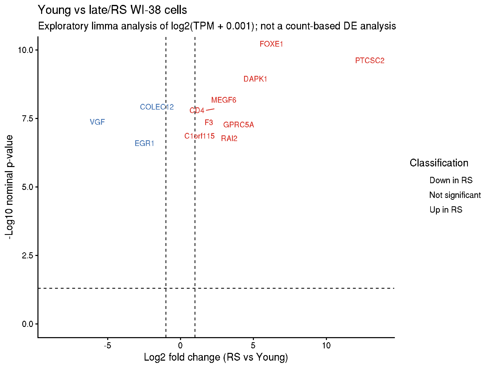
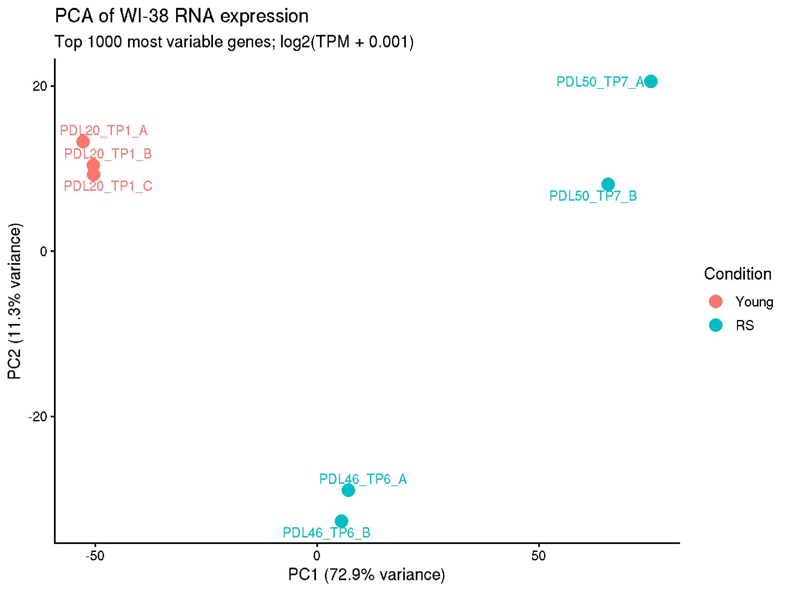

# TELOS: Benchmarking AlphaGenome on WI-38 replicative-senescence data

**Status:** work in progress. This repository contains analysis code and documentation; large datasets, genome references, generated predictions, logs, and secrets remain local and are not committed.

## Project question

How accurately can a DNA-sequence model such as AlphaGenome predict experimentally observed regulatory activity in WI-38 fibroblasts, and does prediction performance differ in genomic regions associated with replicative senescence?

The central distinction is between **sequence-associated regulatory patterns** and **cell-state-dependent changes**. AlphaGenome receives a DNA sequence and selected output/track context; it does not directly receive the passage label (young versus senescent) simply because that label exists in the experimental data. The project therefore must not claim that AlphaGenome directly predicts senescence. It evaluates agreement with experimental measurements and characterizes where sequence-based predictions do or do not capture observed activity.

## Current analysis status

Progress recorded on 11 October 2026 from the project notes:

| Step | Status | Inputs / outputs |
|---|---|---|
| Step 0 — define comparison groups | Done | Young: PDL20, 3 replicates. Late/RS: PDL46 + PDL50, 4 replicates. |
| Step 1 — quantify ATAC signal over the atlas | Done | 363,470 atlas peaks; group means and `log2FC_rs_vs_young`; output `1_data_raw/1_preprocessing_and_intermediate/atac_atlas_with_signal.csv` (7 columns). |
| Step 2 — select benchmark regions | Done | 10,000 regions: 2,500 RS-gained, 2,500 RS-lost, 2,500 Stable, 2,500 Negative. Output `1_data_raw/2_benchmark/benchmark_10000.bed`. |
| Step 3 — calculate experimental ground truth | Done | Experimental young/late group signals for the 10,000 regions; output `1_data_raw/2_benchmark/benchmark_10000_groundtruth.csv` (10,000 rows, 8 columns). |
| Step 4.0 — obtain and index hg38 | Done | UCSC-style `hg38.fa` and `hg38.fa.fai` in `1_data_raw/0_reference/hg38/`. |
| Step 4A — AlphaGenome ATAC pilot and track inventory | In progress / verify outputs | Script: `2_scripts/1_Preprocessing/4A_AlphaGenome_ATAC_pilot.py`. Inspect its log and generated output files before marking complete. |
| Step 4B — batch predictions for all benchmark regions | Planned | Choose and document appropriate track(s), then implement checkpoints and resumable output. |

These statuses describe the supplied project notes; rerun or inspect logs before treating them as a reproducible release.

## Repository layout

```text
Telos_NGS_Project/
├── 2_scripts/
│   ├── 1_Preprocessing/
│   │   ├── 1_atac_atlas_with_signal.py
│   │   ├── 2_Select_benchmark_regions.py
│   │   ├── 3_Benchmark_groundtruth_ATAC.py
│   │   ├── 4A_AlphaGenome_ATAC_pilot.py
│   │   └── utils_log.py
│   └── other_script_utils_used_all.txt   # local only; ignored (may contain secrets)
├── docs/
├── envs/
├── scripts/
├── 1_data_raw/                           # local only; ignored by Git
├── .gitignore
├── CONTRIBUTING.md
└── README.md
```

`1_data_raw/` is deliberately excluded from Git. Each contributor downloads or obtains data locally and follows `docs/01_DATA_DOWNLOAD.md`. `scripts/create_local_dirs.sh` recreates the expected local directory layout.

## Quick start

1. Read [the project aim](docs/00_PROJECT_AIM.md), [the workflow](docs/02_ATAC_WORKFLOW.md), and [the contribution rules](CONTRIBUTING.md).
2. Create the required local directories: `bash scripts/create_local_dirs.sh`.
3. Install the relevant tools in an isolated Conda environment. See [environment setup](docs/04_ALPHAGENOME_SETUP.md) and the starter file `envs/alphagenome-env.yml`.
4. Obtain the required source data and hg38 reference locally. Do not commit them.
5. Run the scripts in numbered order, inspect each log and output, and record software versions and commands.

## Data and credentials policy

- Never commit `1_data_raw/`, FASTA/FAI references, bigWig files, downloaded GEO archives, generated BED/CSV outputs, logs, or prediction arrays.
- Never commit API keys, `.env` files, access tokens, service-account JSON files, or local notes that contain credentials.
- `2_scripts/other_script_utils_used_all.txt`, `workflow.odt`, `workings.odt`, and downloaded research PDFs are excluded by default. Put cleaned, shareable methodology into Markdown under `docs/` instead.
- Do not copy experimental data into GitHub merely to demonstrate the workflow. Share links, accession IDs, commands, and schemas instead.
- Before any push, inspect `git status`, `git diff --cached --stat`, and `git diff --cached`.

## Important interpretation caveat

The benchmark includes shuffled negative regions outside the atlas. These may be easier to distinguish from atlas peaks than the gained/lost/stable classes are from one another. Report results by class and region type; do not present performance on shuffled negatives alone as evidence that AlphaGenome can identify senescence-associated changes. Document selection thresholds, random seeds, genome build, signal normalization, target track, and evaluation metrics.

## Sources and citations

The project uses the GSE175533 study and a local UCSC hg38 reference. Keep DOI/accession, sample mapping, data-use notes, and publication citations in the documentation. Do not commit copies of downloaded papers unless the license expressly permits redistribution.

## Generated Visualizations

The following figures are exploratory outputs from the WI-38
young-versus-replicative-senescence RNA-seq analysis.

### RNA-seq figures

**Volcano plot**



[Open the volcano plot PDF](reports/visualizations/static/volcano_plot.pdf)

**Expression heatmap: top 100 genes**


[Open the heatmap PDF](reports/visualizations/static/heatmap_top100_genes.pdf)

**Principal component analysis**



[Open the PCA plot PDF](reports/visualizations/static/pca_young_vs_rs.pdf)

### Interactive plots

The interactive HTML reports are available in
[reports/visualizations/interactive](reports/visualizations/interactive/).

- [Interactive volcano plot](reports/visualizations/interactive/volcano_interactive.html)
- [Interactive heatmap](reports/visualizations/interactive/heatmap_interactive.html)
- [Interactive PCA](reports/visualizations/interactive/pca_interactive.html)

### AlphaGenome locus visualizations

Candidate-gene locus plots are available in
[reports/visualizations/alphagenome_locus_plots](reports/visualizations/alphagenome_locus_plots/).

These figures are generated analysis outputs. The static plots are
exploratory and should not be interpreted as definitive differential-
expression evidence without supporting statistical analysis.
